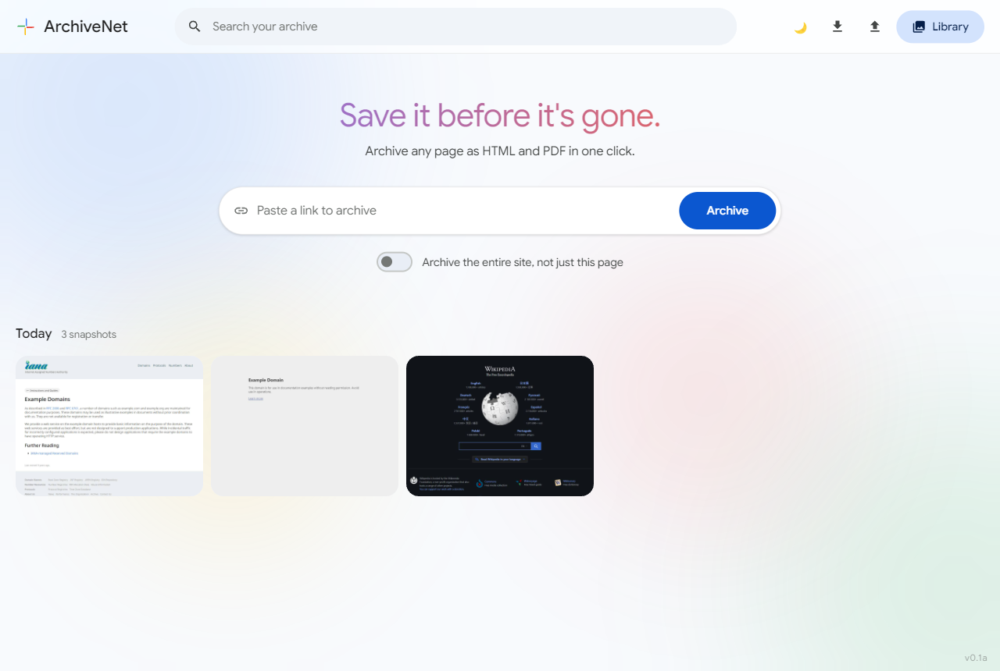
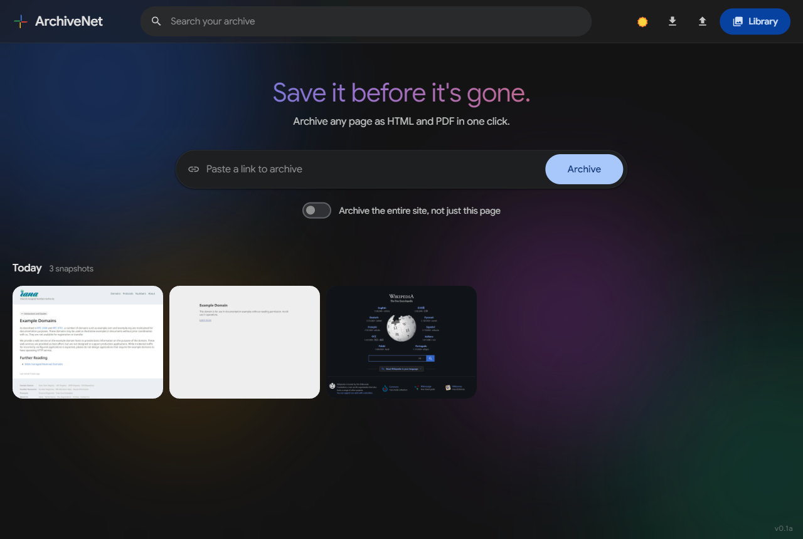
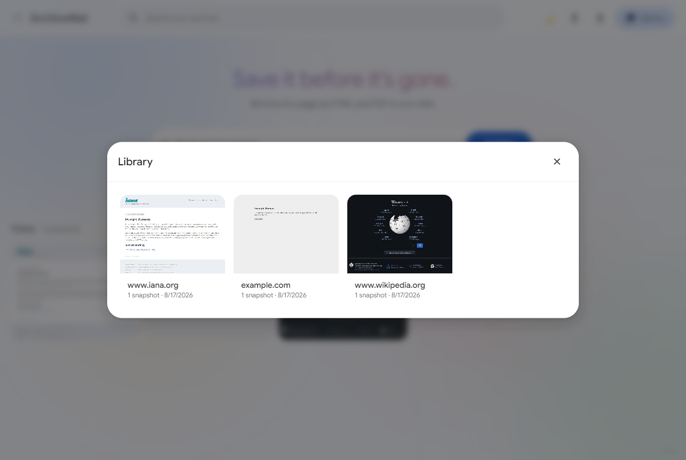
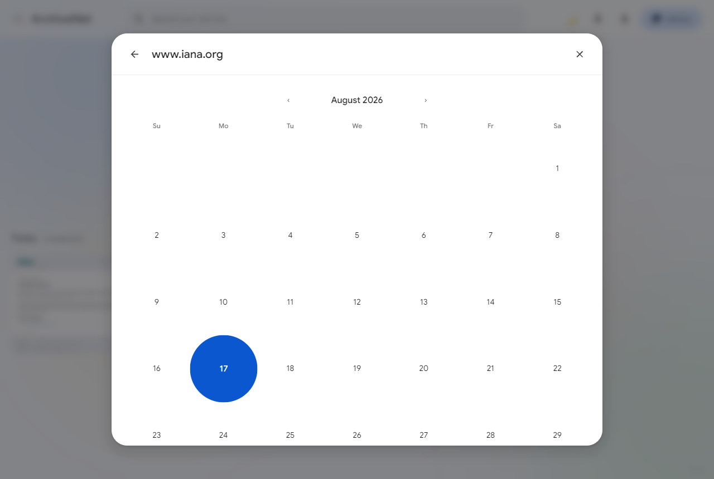
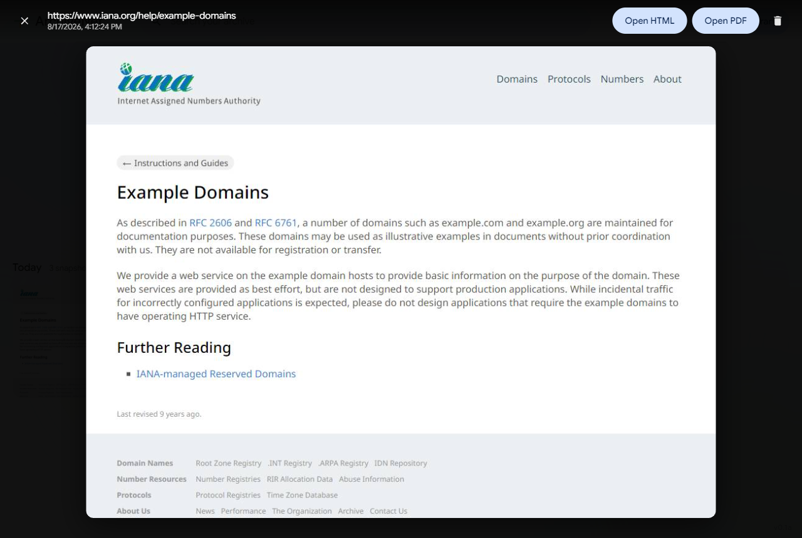

# TimeCapsule


**A self-hosted, open-source alternative to Archive.org and ArchiveBox.** Paste a URL into the address bar and TimeCapsule renders it in headless Chrome, then saves a real, self-contained HTML snapshot, a PDF, and a thumbnail — all on your own disk, under your own control.

Use the archive workspace to save a URL, search saved pages, and browse day-grouped captures in grid or list view. The Library organizes captures by site and date.

## AI usage disclaimer

> [!NOTE]
> Parts of Timecapsule's — code, documentation, and this README included — were
> written with the help of AI coding assistants. Everything is reviewed before
> it ships, but if you spot something that looks off, please open an issue.

## Why AI-assisted development

Features like the bot-check hand-off, Wayback link auto-import, and cancellable background jobs with live progress aren't things ArchiveBox or a `wget --mirror` script does. AI assistance is what made building this specific, non-standard feature set practical for a one-person project.

## Screenshots

These screenshots show the previous interface and its capture workflows.

<table>
<tr>
<td width="50%"></td>
<td width="50%"></td>
</tr>
<tr>
<td align="center"><sub><b>Timeline</b> — light mode</sub></td>
<td align="center"><sub><b>Timeline</b> — dark mode, with the animated aurora background</sub></td>
</tr>
<tr>
<td width="50%"></td>
<td width="50%"></td>
</tr>
<tr>
<td align="center"><sub><b>Library</b> — every archived site, thumbnail-first</sub></td>
<td align="center"><sub><b>Calendar</b> — every date a site was archived, Wayback-Machine-style</sub></td>
</tr>
</table>


<p align="center"><sub><b>Viewer</b> — open any snapshot full-screen, with Open HTML / Open PDF / Delete right there</sub></p>

## Contents

- [Why AI-assisted development](#why-ai-assisted-development)
- [Screenshots](#screenshots)
- [Features](#features)
- [Organizing and importing captures](#organizing-and-importing-captures)
- [Replaying and comparing captures](#replaying-and-comparing-captures)
- [Capture operations](#capture-operations)
- [Roadmap](#roadmap)
- [Installing](#installing)
- [Uninstalling](#uninstalling)
- [Running on a Workstation](#running-on-a-workstation)
- [Managing the Service](#managing-the-service)
- [Hosting as a Server](#hosting-as-a-server)
- [How It Works](#how-it-works)
  - [How pages are captured](#how-pages-are-captured)
  - [Archive depth](#archive-depth)
  - [Advanced archive options](#advanced-archive-options)
  - [Progress, cancelling, and human verification](#progress-cancelling-and-human-verification)
  - [Importing from the Wayback Machine](#importing-from-the-wayback-machine)
  - [AI summaries & tags](#ai-summaries--tags)
  - [Change detection](#change-detection)
  - [Directory layout](#directory-layout)
  - [Export and import](#export-and-import)
  - [Concurrency](#concurrency)
  - [Settings file (config.json)](#settings-file-configjson)
  - [Dark mode](#dark-mode)
  - [Logging](#logging)
- [Configuration reference](#configuration-reference)
- [Requirements](#requirements)

## Features

| Feature | What it does |
|---|---|
| **Archive** | Paste a URL, get back a self-contained single-file HTML snapshot (`page.html`, every stylesheet/image/font inlined as `data:` URIs) + a full-page vector PDF + a thumbnail, saved to disk. |
| **WARC capture** | Every archive also saves `page.warc.gz` — a real [WARC/1.1](https://iipc.github.io/warc-specifications/) file built from the actual HTTP request/response pairs Chromium made while loading the page, parseable by warcio/pywb/ReplayWeb.page. Capped at the same per-resource size limit as the HTML inlining, so very large resources appear as headers without a full replayable body — see [How pages are captured](#how-pages-are-captured). |
| **Custom User-Agent, extra wait, cookie import & save toggles** | "Advanced options" under the address bar lets you override the browser's User-Agent, add extra time after the page loads (for slow JS-heavy sites), import cookies (Netscape `cookies.txt` or JSON) so paywalled or logged-in pages archive as you'd actually see them, and toggle whether images get saved into the archive (vs. linked back to the original) and whether video/audio download runs at all. |
| **Live progress & cancel** | Archiving runs as a background job with a small circular progress indicator (bottom-right) showing which capture stage is running, plus a Stop button next to Archive that hard-cancels the job and deletes whatever partial files it had already written. |
| **Human verification hand-off** | If a site throws up a bot-check (Cloudflare, hCaptcha, reCAPTCHA, Turnstile) while archiving, TimeCapsule opens a second, visible browser window on your desktop so you can solve it yourself — once cleared, the resulting session cookies are copied back into the headless capture and archiving continues automatically. |
| **Media extractor** | Downloads any video/audio TimeCapsule can find on the page (native `<video>`/`<audio>`, or a YouTube/Vimeo embed) via a lazily-downloaded [yt-dlp](https://github.com/yt-dlp/yt-dlp) binary, saved under `media/` in the archive folder. Best-effort — unsupported sites, oversized files, or pages with no media are silently skipped rather than failing the archive. Can be hard-disabled instance-wide via `ENABLE_MEDIA_DOWNLOADS` in `config.js`. |
| **Full-page screenshot** | A separate `screenshot.png` capturing the *entire* rendered page top to bottom (not just the viewport-sized thumbnail used in the grids) — for citations, visual records, or just seeing the whole page at a glance without opening the HTML. Shown as an "Open Screenshot" button wherever a snapshot appears. |
| **Clean article extraction** | Every archive also runs [Readability.js](https://github.com/mozilla/readability) against the page and, when it looks like an article, saves a clean Markdown (`article.md`) and plain-text (`article.txt`) copy alongside it — byline, excerpt, and title included — with ads, nav, and cookie banners stripped out. Shows up as an "Open Article" button next to Open HTML / Open PDF wherever a snapshot appears. |
| **Timeline** | Browse captures grouped by day in grid or list view. Filter by site or format and open any snapshot from its card. |
| **Archive depth** | Choose how wide each archive run goes: just this page, this page plus its outbound links (the default), or a full recursive crawl of the whole site (warns you first — it's much heavier). See [Archive depth](#archive-depth). |
| **Full-text search** | Search reaches inside every archived page's actual content, not just its URL — an embedded [SQLite FTS5](https://www.sqlite.org/fts5.html) index (`data/search.db`, self-healing: rebuilt for anything missing from it on startup) is checked alongside the existing URL/domain matching, with a highlighted snippet shown for content-only matches. If the native SQLite binding can't load on your platform, search silently falls back to URL/domain-only rather than breaking. |
| **AI summaries & tags** *(optional)* | When `ANTHROPIC_API_KEY` is set, every article-like archive gets a 2–3 sentence summary, a handful of topical tags, and named entities via the Claude API, shown right in the viewer. Off by default (it's the one feature that adds real per-archive latency) — nothing changes until you set the env var. See [AI summaries & tags](#ai-summaries--tags). |
| **Tags and collections** | Add manual tags with or without AI, move snapshots into named collections, and apply tagging, moving, or ZIP export to a selection. |
| **Saved searches** | Combine title, URL, tag, or full-text search with site, date, format, and collection filters. Bookmark the query, filters, and sort order in your browser. |
| **Bulk capture** | Paste a URL list or load a browser bookmarks HTML export. Preview new, existing, and duplicate entries before capturing. |
| **Browser save and quick actions** | Use the bookmarklet to bring the page you’re viewing into TimeCapsule. Open quick actions with Ctrl+K or Command+K. |
| **URL canonicalization & dedup** | Incoming URLs are normalized (tracking params like `utm_*`/`fbclid` stripped, host lowercased, trailing slash and fragment removed) before archiving, so the same article reached through different tracking links is recognized as the same page. A plain, unconfigured re-request for a URL archived in the last 5 minutes reuses that snapshot instead of re-capturing — an explicit User-Agent, extra wait, or cookies always forces a fresh capture, though. |
| **Change detection & text diffs** | Re-archiving a URL compares its text with the previous snapshot. Review added and removed lines and compare two captures in the viewer. |
| **Library** | A thumbnail grid of every archived site; click through to a Wayback-Machine-style calendar of every date it was archived. Delete a single day's snapshots from the calendar, or an entire site's history from the grid. |
| **Export / Import** | Back up everything to a single `.zip` and restore it later — including onto a different OS. |
| **Wayback Machine import** | Look up a URL's existing snapshots on web.archive.org (via the CDX API) and import one directly - it goes through the exact same capture pipeline as a live archive (PDF, screenshot, WARC, article extraction) via a real browser render of the fetched HTML, and is filed under the date it was *actually* captured on the web, not today. Pasting a `web.archive.org/web/...` link straight into the main Archive bar is also recognized and routed the same way. See [Importing from the Wayback Machine](#importing-from-the-wayback-machine). |
| **Concurrent archiving** | More than one archive/import job can run its Puppeteer work at once (capped at `MAX_CONCURRENT_ARCHIVES` in `config.js`, default 2) - extra requests queue and start automatically as a slot frees, rather than blocking or getting rejected. Media downloads within a page's media pass run concurrently too (`MAX_CONCURRENT_MEDIA_DOWNLOADS`). |
| **Dark mode** | Follows the system theme by default and remembers a manual choice from the header. |
| **Logging** | Prints progress to the terminal as pages are archived, and appends every archive request (URL + requester IP) to `traffic.log`. |

## Organizing and importing captures

- Open a snapshot and choose **Organize**, or use **Select** and **Review actions** for several snapshots. Add or remove manual tags, move captures to a new or existing collection, or export the reviewed selection as a ZIP. Use **Collections** to browse or organize a whole collection. Moving all its captures to a new name renames it, and leaving the collection name blank unfiles them.
- Use **Save search** to bookmark the history query, filters, and sort order on this browser. Capture tags and collection membership travel with the snapshots in a ZIP backup.
- Choose **Bulk capture** to paste a list or upload a browser bookmarks HTML file. Review up to 200 URLs per batch. Repeated URLs within a batch are skipped, and you can choose to capture previously saved URLs again. A batch captures one page per URL and can file the results in a collection. Keep the TimeCapsule tab open while a batch runs.
- Choose **Browser save** and drag the bookmarklet to your bookmarks bar. Use it on a web page to open TimeCapsule with that page’s URL filled in, then choose your capture settings and save.

## Replaying and comparing captures

Open a snapshot to switch between its saved HTML, PDF, screenshot, Reader, and WARC views. The format bar shows which files are available. WARC replay renders captured HTML with saved images, styles, and fonts offline. It runs with scripts disabled and may omit resources whose response bodies were unavailable when the page was captured.

Choose **Compare versions** to select two captures of the same URL. The viewer shows the screenshots and saved text side by side and highlights text changes. Older captures can use their thumbnail and text extracted from the saved HTML. Open **Calendar** from the sidebar to browse captures across the archive by date and see which ones changed.

## Capture operations

- **Jobs** shows queued, running, completed, failed, and cancelled captures with their latest stage. Cancel unfinished jobs or retry a failed or cancelled capture from the dashboard. Queued jobs resume after a restart. A capture interrupted while running can be retried. Captures submitted with cookies need a fresh cookie file after a restart.
- **Schedules** runs recurring captures of a URL on the server. The schedule retains its next run and can be paused or run immediately. Review the URL’s capture history and in-app notifications for changes or failures.
- **Storage** reports disk use by format. Preview a retention rule by age and optional site, then confirm deletion of the listed snapshots. The preview expires after five minutes.
- **Failed assets** in the viewer lists network and HTTP failures recorded during capture. Retrying a resource saves a separate downloadable file beside the original snapshot.
- Set `ENABLE_OCR` to `true` and install Tesseract on the server to index screenshot text after capture. OCR runs one screenshot at a time with a two-minute timeout. [Tesseract](https://tesseract-ocr.github.io/tessdoc/Command-Line-Usage.html)

For smaller hosts, set `MAX_CONCURRENT_ARCHIVES` to `1` and tune `MAX_CAPTURE_SECONDS` in `config.json`. If you use systemd, you can also set `CPUQuota`, `MemoryHigh`, and `MemoryMax` in a service drop-in to cap the resource use of TimeCapsule and its capture processes. [systemd resource controls](https://freedesktop.org/software/systemd/man/latest/systemd.resource-control.html)

## Roadmap

See [roadmap.md](roadmap.md) for the phased plan covering organization, replay, capture operations, and hosting.

## Installing

**Prerequisites:** [Node.js](https://nodejs.org/) 18 or newer. On Linux you'll also need a handful of Chromium system libraries — see [Requirements](#requirements).

```
git clone <this-repository-url>
cd TimeCapsule
npm install
```

The first install downloads a bundled Chromium via Puppeteer's postinstall script. If your environment blocks install scripts (e.g. npm's `allow-scripts` guard, or a locked-down CI runner), approve it first, then install again:

```
npm approve-scripts puppeteer
npm install
```

### Linux: install and update scripts

On Linux, two scripts in the project root do the setup and upkeep for you. Run them as a regular user (not root) that has `sudo`:

```
git clone <this-repository-url>
cd TimeCapsule
bash install.sh
```

`install.sh` walks through, and skips anything already done:

1. Installs `git`, `curl` and the system libraries headless Chromium needs (apt, dnf/yum or pacman; the renamed `t64` packages on Ubuntu 24.04 are handled), and Node.js 18+ from NodeSource if you don't have it.
2. Runs `npm ci`. If a native dependency needs missing build tools, the installer offers to install Python 3, `make`, and a C++ compiler, then retries. It also checks that Chromium can start and reports missing libraries or sandbox errors.
3. Asks for a port and offers to create a **systemd service** — a system-wide one that starts at boot (recommended), or a user service that needs no root (with optional "linger" so it starts at boot too). It's enabled and started, then checked over HTTP.

It's safe to re-run, and `--yes` accepts every default for unattended use. Useful options: `--port N`, `--service system|user|none`, `--skip-deps`, `--no-start`, and `--dry-run` to print everything it would do (including the exact unit file) without changing anything. `bash install.sh --help` lists them all.

**If the Chromium download fails.** Puppeteer downloads its own Chromium (~150 MB) into `~/.cache/puppeteer`. If that gets interrupted (Ctrl+C, a dropped connection, a full disk) it can leave an empty version folder behind, and every later install then fails with `The browser folder ... exists but the executable ... is missing`. The installer (and `update.sh`) now clears such leftovers automatically before installing. If the download itself keeps failing, it installs everything else, shows the downloader's real error, and tells you what to check — usually no route to `storage.googleapis.com`, a proxy that needs `HTTPS_PROXY` set, or a full disk (`df -h ~`). Re-run `bash install.sh` once that's sorted; nothing already done is repeated. To clear it by hand: `rm -rf ~/.cache/puppeteer`.

**If `node-gyp` reports missing build tools.** On Arch Linux or Manjaro, install them with `sudo pacman -S --needed python make gcc`. On Debian or Ubuntu, use `sudo apt-get install python3 make g++`. On Fedora, use `sudo dnf install python3 make gcc-c++`. Then rerun `bash install.sh` as your regular user.

To get onto the latest commits later:

```
bash update.sh          # fetch, update, reinstall dependencies only if they changed, restart the service
bash update.sh --check  # just report whether an update is available
```

`update.sh` never touches your data — `archived/`, `data/`, `bin/` and `traffic.log` aren't tracked by git, and the script never runs `git clean` or a hard reset against them. Your own settings are best kept in [`config.json`](#settings-file-configjson), which git doesn't track, so it's never in the update's way at all. If you've edited a tracked file anyway (typically `config.js`), your edits are set aside and re-applied on top of the new version. If they can't be merged cleanly, the whole update is rolled back and nothing changes — you're never left with half an update or conflict markers in a file the server loads. A failed `npm install` is rolled back the same way, and the service is restarted only if it was running before.

## Uninstalling

On Linux, run the uninstaller as the account that installed TimeCapsule. Export any snapshots you want to keep to a folder outside the checkout, and stop any instance you started directly with `npm start`.

```bash
bash uninstall.sh --dry-run
bash uninstall.sh
```

The script removes matching systemd services and PM2 registrations, then permanently deletes the entire checkout. This includes the source and Git history, saved snapshots, media, the search index, local settings, dependencies, and traffic logs. Use `--yes` for non-interactive removal or `--install-dir PATH` to target a checkout from a separate copy of the script.

Externally managed copies and integrations require separate cleanup. These include mounted archive volumes, exports outside the checkout, Docker deployments, reverse proxies, browser site data, and logs outside the checkout such as the system journal and PM2 logs. Shared system packages and the Puppeteer cache remain available to other applications.

## Running on a Workstation

For personal, local-only use — nothing else needs to reach it:

```
npm start
```

Open `http://localhost:3000`, archive some pages, and press `Ctrl+C` in the terminal when you're done. That's the whole workflow: no background service, no database, just this one process while you're using it. Archived files land in `archived/` right next to the project.

### Running on a custom port

If 3000 is taken (or you just want a different port), there are two ways to change it. Either way, the startup line tells you what it picked: `TimeCapsule running at http://localhost:8080`.

**1. In `config.json` — the permanent way.** Create a file called `config.json` next to `server.js` (there's a ready-made `config.example.json` to copy) containing the port:

```json
{
  "PORT": 8080
}
```

```
cp config.example.json config.json   # then edit the number (on Windows: copy config.example.json config.json)
npm start
```

Now every `npm start` — and the systemd/pm2 service, after a restart — uses port 8080. `config.json` is gitignored, so `git pull` and [`update.sh`](#linux-install-and-update-scripts) never touch it or conflict with it. The port must be a whole number from 1 to 65535; anything else (or a file that isn't valid JSON) stops the server at startup with a message saying what to fix, rather than quietly running on the wrong port. The same file can override every other setting in `config.js` — see [Settings file (config.json)](#settings-file-configjson).

**2. With the `PORT` environment variable — for a one-off run.** It takes priority over `config.json`, so it's handy for trying something without editing a file:

```
PORT=8080 npm start                    # Linux / macOS
$env:PORT = 8080; npm start            # Windows PowerShell
set PORT=8080&& npm start              # Windows cmd.exe
```

Order of precedence: the `PORT` environment variable, then `config.json`, then the built-in default of 3000.

## Managing the Service

This section is for running TimeCapsule continuously — e.g. always-on on a home server or NAS — as opposed to starting it only when you want to use it.

**Starting / stopping / restarting**, using [pm2](https://pm2.keymetrics.io/) as a process manager:

```
npm install -g pm2
pm2 start server.js --name timecapsule   # start
pm2 stop timecapsule                     # stop
pm2 restart timecapsule                  # restart
pm2 logs timecapsule                     # tail logs
```

Running it as a systemd service instead is covered under [Hosting as a Server](#hosting-as-a-server) — that also makes it survive a reboot.

**Updating to a new version:**

```
git pull
npm install
pm2 restart timecapsule   # or just re-run `npm start` if you run it in the foreground
```

`npm install` re-checks Puppeteer's bundled Chromium and only re-downloads it if the required version changed. On Linux, `bash update.sh` does all of this for you and handles the systemd service too — see [Linux: install and update scripts](#linux-install-and-update-scripts).

**Backing up:** everything TimeCapsule knows lives under `archived/`. Click **Export backup** in the sidebar (or hit `GET /api/export`) to download it as a single `.zip` — see [Export and import](#export-and-import) for the full picture, including moving to a different OS entirely.

**Changing the port:** put `{ "PORT": 8080 }` in `config.json` (see [Running on a custom port](#running-on-a-custom-port)) and restart the service — `pm2 restart timecapsule`, or `sudo systemctl restart timecapsule` for systemd (`systemctl --user restart timecapsule` for a user service). That's the same file whether you run under pm2, systemd or by hand, and updates never overwrite it. The `PORT` environment variable also works and takes priority over `config.json`: with pm2, set it on the first launch (`PORT=8080 pm2 start server.js --name timecapsule`), which pm2 remembers; in a systemd unit it's an `Environment=PORT=8080` line. If a unit already has such a line, `config.json` will appear to be ignored — edit or remove the line instead. Whatever port you choose, update your reverse proxy and firewall to match.

## Hosting as a Server

TimeCapsule is a plain Node/Express process — any host that can run a long-lived Node service works, from a spare machine at home to a small VPS. This walks through setting it up on a **dedicated server that stays on 24/7**, so it just keeps archiving whenever you need it without you having to start it by hand.

1. **Get the code onto the server** and run `npm install` there (Chromium is downloaded per-platform, so don't just copy `node_modules/` from a different OS).
2. **Keep it running** with pm2 (see [Managing the Service](#managing-the-service)) and make it survive reboots:
   ```
   pm2 save
   pm2 startup   # wires pm2 into your OS's boot process
   ```
   Or use a systemd unit instead:
   ```ini
   # /etc/systemd/system/timecapsule.service
   [Unit]
   Description=TimeCapsule
   After=network.target

   [Service]
   WorkingDirectory=/opt/timecapsule
   ExecStart=/usr/bin/node server.js
   Environment=PORT=3000
   Restart=on-failure
   User=timecapsule

   [Install]
   WantedBy=multi-user.target
   ```
   Then `sudo systemctl enable --now timecapsule`. (`bash install.sh` can write and enable this unit for you — see [Linux: install and update scripts](#linux-install-and-update-scripts).)
3. **Put a reverse proxy in front of it** (nginx, Caddy, etc.) to handle TLS and your domain name, proxying to `http://127.0.0.1:3000`. Caddy example:
   ```
   archive.yourdomain.com {
     reverse_proxy 127.0.0.1:3000
   }
   ```
   If you plan to use [recursive archiving](#recursive-archiving) on larger sites, raise your proxy's read/response timeout (e.g. nginx's `proxy_read_timeout`) — the request to `/api/archive` doesn't return until the whole crawl finishes, and a big one can take a while.
4. **Persist the `archived/` directory.** It holds every saved archive, so back it up like you would a database and, if you containerize the app, mount it as a volume rather than baking it into the image.
5. **Access control.** Configure [shared access](#shared-access) to require a login, and serve TimeCapsule through HTTPS. Use a VPN or firewall to limit who can reach a personal instance.

### Shared access

Set `TIMECAPSULE_USERS_FILE` to the absolute path of a JSON accounts file outside the archive. Restart TimeCapsule after changing the file. Accounts use HTTP Basic authentication, so terminate TLS at the reverse proxy and preserve the original `Host` header. With no accounts file configured, the instance uses its existing single-user mode without a login.

```json
[
  { "username": "operator", "role": "admin", "passwordHash": "<generated hash>" },
  { "username": "collector", "role": "capture", "passwordHash": "<generated hash>" },
  { "username": "reviewer", "role": "reader", "passwordHash": "<generated hash>", "collections": ["Research"] }
]
```

- **Admin** can manage snapshots, schedules, backups, retention, and public mirrors.
- **Capture** can browse the archive, submit new captures, and manage their own capture jobs.
- **Reader** can browse and replay snapshots in assigned collections. Use collection names exactly as they appear in the workspace. Raw WARC downloads are reserved for administrators in shared mode.

Generate a separate hash for each account. This Bash command reads the password without echoing it and prints the hash for the JSON file.

```bash
read -rsp 'Password: ' tc_password
printf '\n' >&2
printf '%s' "$tc_password" | node -e '
  const fs = require("node:fs");
  const { randomBytes, scryptSync } = require("node:crypto");
  const salt = randomBytes(16);
  const password = fs.readFileSync(0);
  const hash = scryptSync(password, salt, 64);
  console.log(["scrypt", salt.toString("hex"), hash.toString("hex")].join("$"));
'
unset tc_password
```

### Archive storage and S3

TimeCapsule uses a writable filesystem as its working archive. To store captures on SMB or NFS, mount the share persistently, set `TIMECAPSULE_ARCHIVE_DIR` to its mount path, and grant the TimeCapsule service account read and write access. Start the service after the mount is available. For systemd you can use `RequiresMountsFor=/path/to/archive` in the unit. Keep `data/` on local disk and run one writer per archive.

To use S3, install AWS CLI v2 for the service account, configure its credentials, and set `TIMECAPSULE_S3_URI=s3://bucket/prefix`. For an S3-compatible provider, also set `TIMECAPSULE_S3_ENDPOINT`. Set `TIMECAPSULE_S3_REPLICATE=1` to replicate new captures and organization changes under `captures/`. [AWS CLI S3 sync](https://docs.aws.amazon.com/cli/latest/reference/s3/sync.html)

Create a complete checkpoint under **Operations → Storage → Back up to S3**. Checkpoints include snapshot files and their organization metadata. Verify a backup by restoring it from **Operations → Storage** on a separate instance with an empty archive directory on a writable filesystem. TimeCapsule checks each downloaded file against the saved SHA-256 manifest before activating the restore. For a mounted share, use a local restore directory and copy the verified archive to the share while its service is stopped. Keep a separate backup of local configuration, account files, and `data/` if you also need schedules and job history.

### Public mirrors

Set `TIMECAPSULE_WAYBACK_KEY` and `TIMECAPSULE_WAYBACK_SECRET` to the Internet Archive API credentials. An admin can then opt in an individual collection under **Operations → Public mirrors**. Future captures filed into that collection submit the original URL to the public Wayback Machine. TimeCapsule skips Wayback imports and captures marked as using imported session cookies. The dashboard records the submission receipt. Disable the setting to stop future submissions. [Internet Archive Save Page Now integration](https://github.com/internetarchive/openlibrary/blob/master/openlibrary/core/ia.py)

### Docker (optional)

If you prefer a container, Puppeteer's official base image already includes Chromium and its dependencies:

```dockerfile
FROM ghcr.io/puppeteer/puppeteer:22.15.0
WORKDIR /app
COPY package*.json ./
RUN npm install
COPY . .
ENV PORT=3000
EXPOSE 3000
CMD ["node", "server.js"]
```

Mount `archived/` as a volume so archives survive container restarts:

```
docker build -t timecapsule .
docker run -d -p 3000:3000 -v $(pwd)/archived:/app/archived --name timecapsule timecapsule
```

### Keeping it healthy long-term

A couple of things are worth checking in on periodically once TimeCapsule has been running unattended for a while, since neither grows on its own until you notice — they just quietly get bigger:

- **`archived/` grows without limit.** Every archive adds an HTML file, a PDF, and a thumbnail, and [recursive archiving](#recursive-archiving) multiplies that by up to 100 pages per run. Keep an eye on free disk space (`df -h` on Linux) and prune old sites you don't need from the [Library](#features) view, or export and move them elsewhere with [Export and import](#export-and-import).
- **`traffic.log` grows without limit too**, one line per archive request forever. On Linux, hand it to `logrotate` rather than letting it grow unbounded:
  ```
  # /etc/logrotate.d/timecapsule
  /opt/timecapsule/traffic.log {
    weekly
    rotate 8
    compress
    missingok
    notifempty
  }
  ```
- **Crash recovery is already handled** by the setup above — pm2 restarts a crashed process automatically, and the systemd unit's `Restart=on-failure` does the same — so there's nothing extra to configure there, just something worth knowing is already covered.

## How It Works

### How pages are captured

Getting a faithful, self-contained snapshot from a live page takes more than one `page.content()` call, so `lib/archiver.js` does the following for every URL it archives:

1. Loads the page and waits for the network to go idle, recording every HTTP request/response pair Chromium makes along the way (used for step 9's WARC file) - with a custom User-Agent and imported cookies already applied, if you set either under [Advanced archive options](#advanced-archive-options). If the page comes back as a bot-check (Cloudflare, hCaptcha, reCAPTCHA, Turnstile) instead of real content, a second, visible browser window opens on your desktop so you can solve it yourself - the resulting cookies are copied back into the capture and it re-navigates automatically. Only checked for the main URL you typed, not sub-links, since the resolved session cookies carry over to them anyway.
2. **Scrolls through the full page and waits again** (longer, if you set an extra wait under Advanced archive options). Lots of sites only fetch images (or trigger other lazy-loaded content) once an element scrolls into view; without this step those images are missing from both the PDF and the saved HTML.
3. **Runs [Readability.js](https://github.com/mozilla/readability) against a cloned copy of the DOM** and, if the page looks like an article (enough extracted text to be worth it), saves the result as `article.md` and `article.txt` — title, byline, and excerpt included, ads/nav/cookie-banners stripped out. Non-article pages (home pages, search results, etc.) simply don't get these files.
4. Captures the PDF, a small viewport thumbnail for the UI grids, and a separate full-page `screenshot.png` from that fully-loaded state (the full-page capture is skipped, rather than failing the whole archive, if the page is too tall for Chromium's screenshot buffer).
5. **Inlines every stylesheet, image, and font it saw load as a `data:` URI directly into the HTML**, and rewrites any it couldn't capture (too large, blocked, etc.) to an absolute URL instead of a relative one. This is what makes `page.html` open correctly on its own, later, on another machine, with no dependency on the original site still being up or reachable at the same relative paths. Images specifically can be excluded from this via the "Save images" toggle under [Advanced archive options](#advanced-archive-options) - stylesheets and fonts always inline, since skipping those would break the page's layout entirely.
6. **Strips `<script>` tags** from the saved HTML. The DOM has already been fully rendered by that point, so scripts add no visual value in a static snapshot — keeping them would only risk them re-executing against a site that's since changed or gone offline (broken widgets, tracking pings, JS errors).
7. Rewrites `<a href>` links to absolute URLs so they still work (by going back to the live site) when you open an archived page later.
8. **Looks for video/audio worth pulling down** — native `<video>`/`<audio>` sources, or a YouTube/Vimeo embed — and hands anything it finds to [yt-dlp](https://github.com/yt-dlp/yt-dlp), saving whatever comes back under `media/`. Off by default; enable the "Download video/audio" toggle under [Advanced archive options](#advanced-archive-options) to turn it on for a given archive run. Same best-effort spirit as the rest of this list: unsupported sites, no media present, oversized files, or a slow/failed download just mean no `media/` folder, not a failed archive.
9. **Builds `page.warc.gz`** (`lib/warc.js`) from the transactions recorded in step 1 - a `warcinfo` record plus a `response`/`request` record pair per HTTP transaction, gzip-compressed per the WARC spec. Transactions over the same size cap as step 5's inlining (`MAX_INLINE_BYTES`, 8MB) are left out of the WARC entirely, the same as they're left out of the inlined HTML.
10. **Summarizes and tags the article text** via the Claude API - see [AI summaries & tags](#ai-summaries--tags) - only for article-like pages, and only when `ANTHROPIC_API_KEY` is set.
11. **Compares the article text against the last archive of this same URL**, if there is one - see [Change detection](#change-detection) - only for the main URL you typed, not sub-links.

Known limitation: assets loaded from Chromium's disk cache (rather than over the network) can occasionally fail to inline; when that happens the archiver falls back to an absolute URL for that one asset rather than failing the whole capture.

### Archive depth

The "How much to archive" control under the address bar picks one of three depths, sent to `POST /api/archive` as `depth`:

| Depth | What it archives |
|---|---|
| **Just this page** (`page`) | Only the URL you typed. No sub-links at all. |
| **This page + its links** (`links`, the default) | The URL you typed, plus the same-domain links found directly on it, up to `MAX_SUBLINKS` (15). |
| **Entire site** (`recursive`) | Follows same-domain links breadth-first — pages found on those sub-pages get crawled too, and so on — until either there's nothing left to follow or it hits the `MAX_RECURSIVE_PAGES` safety cap (100 pages, including the main one). |

Sub-links found at any depth land in the same place: `archived/<domain>/<timestamp>/sub-links/<path>/<timestamp>/`. Whenever a page had more matching links than the depth's cap allowed, the response (and the completion toast) say so as `truncated: true`, rather than silently archiving only part of what was there.

The UI shows an extra warning before you pick **Entire site**, since a full-site crawl is dramatically heavier than the other two depths: many more pages means many more HTML/PDF/thumbnail files (a lot more disk space) and a much longer archive run, since every page still gets the full capture treatment (scroll, wait, extract article, inline assets, PDF, screenshots) one at a time.

### Advanced archive options

The "Advanced options" disclosure under the depth control (and the matching fields on `POST /api/archive`) cover the cases a plain `fetch()` can't handle - a paywall, a login wall, or a site that's slow to render:

| Option | Request field | What it does |
|---|---|---|
| Custom User-Agent | `userAgent` (string, ≤300 chars) | Overrides Chromium's default User-Agent string for every request the archive makes - useful for sites that serve different content (or block) based on it. |
| Extra wait | `extraWaitMs` (number, 0–30000) | Adds to how long TimeCapsule waits for the network to go idle after scrolling, for slow, JS-heavy pages that need more than the default `LAZY_LOAD_WAIT_MS` (8s) to finish rendering. |
| Cookie import | `cookiesText` (string) | Applies cookies to every page in the archive run before it navigates, so pages behind a login or paywall archive as your session actually sees them. Accepts a Netscape `cookies.txt` export (what most "export cookies" browser extensions produce) or a JSON array of `{name, value, domain, ...}` objects. |
| Save images | `saveImages` (boolean, default `true`) | When off, images are left as links back to the original site instead of being inlined as `data:` URIs - a smaller archive, at the cost of those images disappearing if the source site ever goes offline. |
| Download video/audio | `saveMedia` (boolean, default `false`) | Turns on the yt-dlp media extractor (step 8 above) for this archive run. Off by default since it's the slowest optional step. |

All five are entirely optional and apply to every page in the run (the main URL and every sub-link), not just the first one. A malformed cookies file is rejected up front with a 400 before any browser work starts; an individual cookie missing both `domain` and `url` is skipped rather than failing the whole archive.

### Progress, cancelling, and human verification

`POST /api/archive` returns immediately with `{ jobId }` rather than blocking until the whole archive finishes - the actual capture runs in the background (`lib/jobs.js` tracks it), and the UI subscribes to `GET /api/archive/:jobId/events` (Server-Sent Events) to drive the circular progress indicator in the bottom-right corner. `POST /api/archive/:jobId/stop` hard-cancels a running job: it closes whatever browser page (or human-verification window) is currently in flight, which aborts Chromium/yt-dlp mid-operation, then deletes the partial archive directory that job had already written to disk.

If a site's bot-check trips during the main page's capture, the job's status becomes `awaiting-verification` and a second, visible Chrome window opens - solve the check there and archiving picks back up on its own (see step 1 above). This only does anything useful because TimeCapsule runs on your own desktop with a real display; it's a no-op on a truly headless server.

More than one archive/import job can be running at once - see [Concurrency](#concurrency) below for the cap and how to change it.

### Importing from the Wayback Machine

**Wayback Machine** in the sidebar opens an "Import from Wayback Machine" dialog: paste a URL, and `GET /api/wayback/snapshots?url=` (`lib/wayback.js`) queries the Internet Archive's [CDX API](https://archive.org/help/wayback_api.php) for every distinct HTML snapshot it has of that URL (deduped by content digest, newest first). Pick one and `POST /api/wayback/import` fetches that exact snapshot's raw HTML (the documented `id_` modifier - no Wayback toolbar or link-rewriting mixed in) and runs it through the same background-job machinery as a live archive, described above.

Pasting a link copied straight out of the Wayback Machine itself (`web.archive.org/web/<timestamp>/<url>`) into the main **Archive** bar works too - `POST /api/archive` recognizes that shape before it does anything else, pulls out the original URL and timestamp, and routes the request into the same import path instead of dutifully archiving Wayback's own replay page. Depth/User-Agent/cookies/save-toggles on the request are ignored in that case, since there's only ever one page to import; a toast confirms what happened ("Recognized a Wayback Machine link…") since otherwise it'd look like a plain archive.

The archive bar itself gives an earlier hint too: as soon as its text matches that same shape, a glowing rainbow outline animates around it - purely a client-side cue (the same pattern check as the server's, just for show), so it fades away the instant you edit the URL into something else or hit Archive.

The import doesn't just save the bare HTML: it hands that HTML to `page.setContent()` in a real Puppeteer page (with a `<base>` tag injected so relative URLs resolve against the *original* site) and lets the normal capture pipeline take it from there - PDF, screenshot, WARC, image inlining, Readability article extraction, and AI summaries/tags (if configured) all happen exactly as they would for a live capture. The one thing that's skipped is change detection, since comparing an old imported snapshot against whatever you happen to have archived most recently doesn't mean anything.

Two things worth knowing:

- **Embedded images/CSS are fetched live**, from the original site as it exists today, not from the Wayback Machine - only the page's own HTML is guaranteed to match the historical capture. If the original site is gone, those assets just won't inline, the same graceful degradation as any archive with dead sub-resources.
- **The archive's date reflects the snapshot**, not the day you imported it - it's filed under `archived/<domain>/<the-snapshot's-own-timestamp>/`, so it shows up in the right place in your timeline/library, alongside anything you archived yourself around that date.

### AI summaries & tags

Set the `ANTHROPIC_API_KEY` environment variable before starting TimeCapsule and every article-like archive (the same ones that get `article.md`/`article.txt` - see step 3 below) also gets a 2-3 sentence summary, 3-8 topical tags, and any named people/organizations/places, via the [Claude API](https://claude.com/platform/api) (`claude-opus-5`, `lib/ai-enrich.js`). This is the one optional feature that adds real per-archive latency (an API round trip), so unlike everything else in this list it's off unless you explicitly opt in by setting the key - nothing about a normal archive changes until you do.

The **Tags** button in the sidebar shows manual and AI-generated tags across your archive. When you organize a snapshot, you can copy an AI suggestion into its manual tags. Collections and manual tags also work with AI disabled.

If the API call fails for any reason (rate limit, network error, no credit) the archive still completes normally, just without a summary/tags for that one page.

### Change detection

Re-archiving a URL compares it with the most recent previous snapshot. TimeCapsule compares article text when both snapshots have it and falls back to text extracted from the saved HTML. It records how many lines were added and removed on the main capture.

When text changes, the viewer shows the line counts and offers **View Changes** for a word-level diff. Use **Compare versions** to see both screenshots and text together.

### Directory layout

```
archived/
  example.com/
    2026-07-25_21-35-56/            <- the URL you typed (https://example.com/blog/post)
      page.html
      page.pdf
      page.warc.gz                  <- the same page as a WARC/1.1 file
      thumbnail.jpg
      screenshot.png                <- full-page capture, separate from the small thumbnail above
      article.md                    <- only present when the page looked like an article
      article.txt
      media/                        <- only present when video/audio was found and downloaded
        my-video-title-abc123.mp4
      metadata.json
      sub-links/
        blog/
          post-1/
            2026-07-25_21-36-10/    <- https://example.com/blog/post-1, found on that page
              page.html
              page.pdf
              thumbnail.jpg
              metadata.json
```

- The URL you type always becomes `archived/<domain>/<timestamp>/`, whether or not it has a path.
- Same-domain links discovered on that page are archived inside that same folder, under `sub-links/<path>/<timestamp>/` (see [Archive depth](#archive-depth) for how many).
- The timeline, Library, and calendar views are all derived purely by walking this directory tree (`lib/history.js`) — `archived/` alone is a complete, self-describing copy of everything TimeCapsule knows, no database required to make sense of it.
- The one exception is full-text search: `data/search.db` (a SQLite file, outside `archived/` on purpose - see [Export and import](#export-and-import)) indexes each page's text so search can look inside content, not just URLs. It's disposable - delete it and TimeCapsule rebuilds it from `archived/` the next time it starts.

### Export and import

Everything TimeCapsule knows is just files under `archived/` — folder and file names use only plain ASCII, so the archive tree itself is already portable across Windows/macOS/Linux. Export/Import just wraps that in a single file for convenience:

- **Export backup** (sidebar, or `GET /api/export`) downloads a `.zip` of the entire `archived/` directory.
- **Import backup** (sidebar, or `POST /api/import` with the zip as a `multipart/form-data` field named `archive`) extracts that zip into `archived/` on whatever machine you run it on. Existing archives already on that machine are kept — importing merges rather than replaces, so it's also safe to combine two machines' archives into one.

To move to a different OS: click Export on the old machine, copy the `.zip` over by whatever means (USB drive, cloud storage, `scp`, etc.), [install](#installing) TimeCapsule on the new machine, start it, and click Import. `data/search.db` deliberately isn't part of the export - it's just an index, not a source of truth, and TimeCapsule backfills it for any imported archive it doesn't recognize the next time it starts (see [Directory layout](#directory-layout)).

### Concurrency

The server runs up to `MAX_CONCURRENT_ARCHIVES` captures or imports at once. Additional jobs wait for a slot and appear in the Operations dashboard. The default is ten concurrent jobs. Use a lower value on a small host and set `MAX_CAPTURE_SECONDS` to limit how long a running capture can hold a slot.

This, and everything else in `config.js`, is deliberately a server file rather than a website setting - restart required to change it - since these are all operator decisions (what this machine's hardware can handle, how the homepage looks for everyone hitting it), not something to expose as a per-visitor control. These are the defaults; to change any of them, put just the ones you want in a `config.json` instead of editing this file - see [Settings file (config.json)](#settings-file-configjson):

```js
// config.js (the defaults)
module.exports = {
  PORT: 3000,                          // port the server listens on (the PORT env var still wins if set)
  MAX_CONCURRENT_ARCHIVES: 2,          // simultaneous archive/import jobs
  MAX_CONCURRENT_MEDIA_DOWNLOADS: 2,   // simultaneous yt-dlp downloads within one page's media pass
  SHOW_TIMELINE_FEED: true,            // show the "Today"/"Yesterday" feed on the homepage
  ENABLE_ANIMATED_BACKGROUND: true,    // the capture panel illustration
  ENABLE_MEDIA_DOWNLOADS: true,        // master switch for the yt-dlp backend
};
```

Lower `MAX_CONCURRENT_ARCHIVES` on something like a Raspberry Pi (each job is a real headless-Chromium page load); raise it on a beefier machine. Set `SHOW_TIMELINE_FEED: false` if you'd rather the homepage was just the archive bar - everything's still reachable from Library either way, this only hides the inline feed. Set `ENABLE_ANIMATED_BACKGROUND: false` to keep the capture panel illustration still. Set `ENABLE_MEDIA_DOWNLOADS: false` to hard-disable the yt-dlp backend: `lib/media.js` returns immediately without ever downloading the yt-dlp binary or spawning it, even if a request explicitly asks for media, and the "Download video/audio" advanced option is disabled in the UI to match - useful on a locked-down or bandwidth-constrained host.

### Settings file (config.json)

Every setting in `config.js` can be overridden from a plain JSON file, `config.json`, in the project root — you only list what you want to change:

```json
{
  "PORT": 8080,
  "MAX_CONCURRENT_ARCHIVES": 4,
  "ENABLE_MEDIA_DOWNLOADS": false
}
```

- **Names** are the same as in `config.js` (`PORT`, `MAX_CONCURRENT_ARCHIVES`, `MAX_CONCURRENT_MEDIA_DOWNLOADS`, `SHOW_TIMELINE_FEED`, `ENABLE_ANIMATED_BACKGROUND`, `ENABLE_MEDIA_DOWNLOADS`), and case doesn't matter, so `"port"` works too. Numbers must be whole numbers of 1 or more (`PORT` at most 65535); the true/false ones must be real JSON `true`/`false`.
- **Restart to apply.** Settings are read once at startup.
- **Updates never touch it.** `config.json` is gitignored, which is the point: edit `config.js` directly and a later `git pull` can conflict with your change; `config.json` can't. Copy `config.example.json` to get started.
- **Mistakes are loud.** A file that isn't valid JSON, or a value of the wrong kind, stops the server at startup with a message naming the problem and the file. An unknown name is only warned about and skipped, so a typo like `"PROT"` shows up in the log instead of silently doing nothing.
- **Precedence** — for the port: the `PORT` environment variable, then `config.json`, then the default in `config.js`. Every other setting: `config.json`, then `config.js`.

### Dark mode

TimeCapsule follows your system's light/dark preference (`prefers-color-scheme`) the first time you open it. Use the 🌙/☀️ toggle in the top-right of the app bar to override that — your choice is remembered in the browser (`localStorage`) and takes precedence over the system setting from then on, independently per browser/device.

### Logging

While it's running, TimeCapsule prints one line per event to the terminal, each timestamped:

```
[2026-07-26T05:09:50.014Z] Archive requested: https://example.com/ from ::1
[2026-07-26T05:09:51.903Z]   [::1] archived https://example.com/
[2026-07-26T05:09:51.920Z] Archive completed: https://example.com/ (0 sub-link(s)) for ::1
```

For a recursive or many-sub-link archive, every page gets its own `archived <url>` line (or `failed <url>: <reason>` if that one page couldn't be captured) as it happens, so you can watch the crawl's progress in real time rather than waiting on one big response at the end.

Every top-level archive request also appends one line to `traffic.log` in the project root — the website that was requested, followed by the requester's IP:

```
2026-07-26T05:09:50.014Z https://example.com/ 127.0.0.1
2026-07-26T05:10:00.147Z https://www.iana.org/help/example-domains 192.168.1.42
```

(Sub-links discovered and archived along the way show up in the terminal output, not as separate `traffic.log` lines — the log tracks *requests*, one per site a client actually asked for.) The IP is always normalized to IPv4 where possible — Node's dual-stack server reports IPv4 clients as an IPv6-mapped address (`::ffff:1.2.3.4`) or the IPv6 loopback (`::1`), and both get converted back to plain IPv4 before logging. If TimeCapsule is behind a reverse proxy, the IP recorded is taken from the `X-Forwarded-For` header when present (which nginx and Caddy set by default), falling back to the direct connection's address otherwise.

All of this — what gets printed, what gets written to `traffic.log`, and in what format — is controlled from one place: `lib/logger.js`. Edit `log()` or `logTraffic()` there to change it (e.g. write JSON lines instead, log to a different file, or add fields).

## Configuration reference

Anything listed as living in `config.js` can be overridden without touching that file, by naming it in a `config.json` — see [Settings file (config.json)](#settings-file-configjson).

| Setting | Default | Where | Purpose |
|---|---|---|---|
| `PORT` | `3000` | `config.json` (or `config.js`), or the `PORT` env var | Port the server listens on - see [Running on a custom port](#running-on-a-custom-port). Precedence: env var, then `config.json`, then `config.js` |
| `ANTHROPIC_API_KEY` (env var) | unset | shell environment | Turns on [AI summaries & tags](#ai-summaries--tags). Archiving works identically without it, just without summaries/tags. |
| `MAX_SUBLINKS` | `15` | `lib/archiver.js` | "This page + its links" depth: max links archived from the one page you typed |
| `MAX_RECURSIVE_PAGES` | `100` | `lib/archiver.js` | "Entire site" depth: max total pages crawled per site, including the main page |
| Media items per page | `2` | `lib/media.js` (`MAX_MEDIA_ITEMS`) | Max video/audio files downloaded per archived page |
| Media file size cap | `250M` | `lib/media.js` (`MAX_MEDIA_FILESIZE`) | yt-dlp skips anything larger than this rather than downloading it |
| `MAX_INLINE_BYTES` | `8MB` | `lib/archiver.js` | Max size of a single resource inlined into `page.html` *and* included in `page.warc.gz` |
| Custom User-Agent length cap | `300` chars | `server.js` (`MAX_USER_AGENT_LENGTH`) | Longest `userAgent` value `POST /api/archive` accepts |
| Extra wait cap | `30000` ms | `server.js` (`MAX_EXTRA_WAIT_MS`) | Longest `extraWaitMs` value `POST /api/archive` accepts |
| Cookies text size cap | `200KB` | `server.js` (`MAX_COOKIES_TEXT_LENGTH`) | Largest `cookiesText` payload `POST /api/archive` accepts |
| Dedup window | `5` minutes | `server.js` (`DEDUP_WINDOW_MS`) | How recently a plain, unconfigured re-request for the same URL must have been archived to be served from that snapshot instead of re-captured |
| Human verification timeout | `10` minutes | `lib/archiver.js` (`VERIFY_TIMEOUT_MS`) | How long the visible hand-off browser window waits for you to clear a bot-check before giving up and failing the archive |
| Finished job retention | `10` minutes | `lib/jobs.js` (`JOB_TTL_MS`) | How long a completed/errored/stopped job's status stays queryable via `GET /api/archive/:jobId/events` before it's forgotten |
| `MAX_CONCURRENT_ARCHIVES` | `10` | `config.js` | Capture/import jobs allowed to run at once |
| `MAX_CAPTURE_SECONDS` | `1800` | `config.js` | Time limit for a running capture or import |
| `ENABLE_OCR` | `false` | `config.js` | Index screenshot text after capture with Tesseract |
| `MAX_CONCURRENT_MEDIA_DOWNLOADS` | `2` | `config.js` | yt-dlp downloads allowed to run at once within a single page's media pass |
| `SHOW_TIMELINE_FEED` | `true` | `config.js` | Whether the "Today"/"Yesterday" recent-snapshots feed shows on the homepage |
| `ENABLE_ANIMATED_BACKGROUND` | `true` | `config.js` | Whether the capture panel illustration animates |
| `ENABLE_MEDIA_DOWNLOADS` | `true` | `config.js` | Master switch for the yt-dlp backend - `false` hard-disables video/audio download entirely |

## Requirements

- [Node.js](https://nodejs.org/) 18 or newer.
- No Python and nothing else to install for the media extractor: the first time TimeCapsule finds video/audio to download, it fetches a standalone [yt-dlp](https://github.com/yt-dlp/yt-dlp) binary for your OS into `bin/` (like Puppeteer does for Chromium) and reuses it after that. Needs outbound internet access the first time; every archive before that point works normally, just without media downloads.
- Full-text search uses [`better-sqlite3`](https://github.com/WiseLibs/better-sqlite3), a native module that ships prebuilt binaries for common platforms via `npm install` - no compiler needed on those. If it can't load on yours (an unusual OS/arch with no prebuilt binary available), TimeCapsule logs a warning and keeps running with URL/domain-only search rather than failing to start.
- On Linux, Chromium (used via Puppeteer) needs a few system libraries. If `npm start` fails to launch the browser, install them, e.g. on Debian/Ubuntu:
  ```
  sudo apt-get install -y ca-certificates fonts-liberation libasound2 libatk-bridge2.0-0 \
    libatk1.0-0 libcups2 libdbus-1-3 libdrm2 libgbm1 libgtk-3-0 libnspr4 libnss3 \
    libxcomposite1 libxdamage1 libxfixes3 libxkbcommon0 libxrandr2 xdg-utils
  ```
